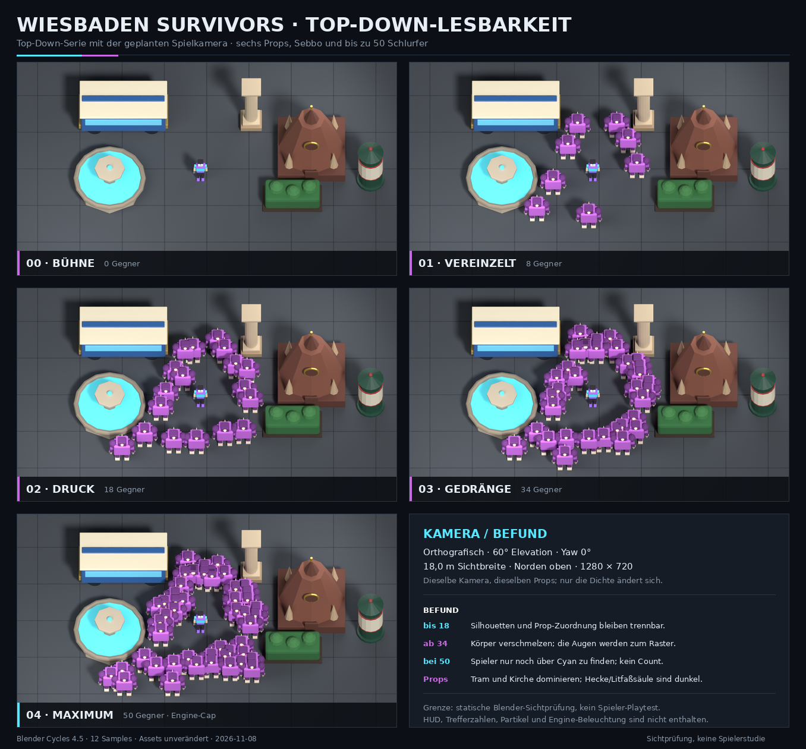

# Top-Down-Kamera: Lesbarkeit von Props und Gegnern im Gedränge (2026-11-08)

GRADES spec=8 design=7 correctness=8 quality=7; biggest gap: statische Blender-Sichtprüfung ohne HUD, Trefferzahlen, Partikel oder echte Spielerinteraktion. Der Portierungsplan legt nur „orthografisch oder leicht perspektivisch“ fest; die hier verwendete Kamera ist deshalb eine dokumentierte Referenzannahme, kein bereits implementierter Engine-Wert.

## Auftrag und Ergebnis

Gerendert wurde eine Serie mit **einer festen geplanten Spielkamera**, sechs vorhandenen
Arena-Props, Sebbo und **0 / 8 / 18 / 34 / 50 Schlurfern**. Die 50 Gegner sind die
dokumentierte Engine-Obergrenze (`_maxSimultaneous = 50`), nicht eine neue Spawn-Regel.
Die Szene nutzt ausschließlich die vorhandenen GLBs aus `assets/glb`; es wurden keine
neuen Modelle, Materialien oder Engine-Dateien angelegt.

**Kontaktblatt:** [contact-sheet.png](pw/camera-readability/contact-sheet.png)



Einzelbilder:

| Stufe | Bild | Gegner |
| --- | --- | ---: |
| Bühne | [00_stage.png](pw/camera-readability/00_stage.png) | 0 |
| Vereinzelte Gegner | [01_sparse.png](pw/camera-readability/01_sparse.png) | 8 |
| Druck | [02_pressure.png](pw/camera-readability/02_pressure.png) | 18 |
| Gedränge | [03_crowd.png](pw/camera-readability/03_crowd.png) | 34 |
| Maximum | [04_max.png](pw/camera-readability/04_max.png) | 50 |
| Spieler-Detail bei 50 | [04_max_player_detail.png](pw/camera-readability/04_max_player_detail.png) | 50 |

## Kamera

| Parameter | Wert |
| --- | --- |
| Projektion | orthografisch |
| Elevation | 60° über der Horizontalen (Blender-Kamera-X-Rotation 30°) |
| Yaw | 0°; Norden oben |
| Sichtbreite | 18,0 m |
| Auflösung | 1280 × 720 (16:9) |
| Bildebene | 10,125 m hoch |
| sichtbarer Boden in Y | ca. 11,69 m (18 m × 9/16 / sin 60°) |
| Renderer | Blender 4.5.15 LTS, Cycles CPU, 12 Samples, Denoise |

Die 18-m-Breite ist an das bestehende Referenzfenster des HTML-Spiels
(1130 × 640) angelehnt und bewusst über alle Dichtestufen **konstant**. Damit
misst die Serie den Effekt der Gegnerdichte und nicht einen zusätzlichen
Kamera-Zoom. Das HTML-Spiel zoomt bei dichtem Gedränge um bis zu 16 % heraus;
diese adaptive Komponente ist hier absichtlich nicht enthalten.

Bei 1280 × 720 ergibt sich rechnerisch eine Spielerhöhe von rund **58 px** und
eine Schlurfer-Breite von rund **92 px**. Die Kamera zeigt damit ungefähr die
Größenordnung der aktuellen 2D-Darstellung, nicht eine Inventar- oder
Porträtansicht.

**Wichtig:** Der Portierungsplan nennt keinen konkreten Winkel. 60° ist die
erste reproduzierbare Referenz für diese Serie. Ob 60° oder ein steilerer
Winkel (z. B. 65–70°) für das fertige Spiel besser ist, muss mit HUD,
Trefferfeedback und Gegnern hinter hohen Props erneut geprüft werden.

## Szene

- **Props:** `SM_KochbrunnenBecken`, `SM_KurgartenHecke`, `SM_KurhausSaeule`,
  `SM_Litfasssaeule`, `SM_NerobergbahnWagen`, `SM_MarktkircheSpitze`.
- **Spieler:** `SK_Sebbo`, Blick leicht zur Kamera gedreht, Idle-Pose.
- **Gegner:** 50 Instanzen von `SM_Schlurfer`, in zehn lockeren Clustern um den
  Spieler; Positionen mit festem Seed. Die Gegner halten einen kleinen Abstand
  zu Props und Spieler, damit die Szene lesbar bleibt; es ist kein
  Flow-Field-/Navigationstest.
- **Boden:** neutrale dunkle Fläche mit 2-m-Raster. Das Raster dient nur als
  Maßstab und ist absichtlich kontrastarm.
- **Keine Engine:** Die Bilder sind Cycles-Renders, keine UE-Screenshots. HUD,
  Schadenszahlen, Partikel, Beleuchtung und Materialien der späteren Engine
  fehlen.

## Befund

### 1. Kamera und Maßstab

Die 60°-Orthokamera funktioniert für die Grundorientierung: Alle sechs Props
sind vollständig im Bild, kein Prop oder Gegner läuft in den Crop
(`crop_flags: {}`). Die Aufsicht zeigt genug von den Körpern, um Spieler und
Gegner zu unterscheiden, und genug von den Dächern, um Props als Hindernisse zu
lesen. Ein reiner 90°-Blick würde die Figuren auf Kopfflächen reduzieren; 60°
ist ein brauchbarer Kompromiss.

Die orthografische Projektion verstärkt allerdings die Flächenwirkung hoher
Props: Der Kirchturm und der Wagen wirken als große, flache Farbflächen. Das ist
kein Fehler der Kamera, aber ein Grund, die Prop-Materialien und -höhen im
3D-Bau getrennt zu prüfen.

### 2. Spieler im Gedränge

Sebbo bleibt über seine **cyanfarbene Jacke** in allen fünf Bildern auffindbar.
Bei 34 Gegnern ist die Silhouette noch vollständig sichtbar; bei 50 Gegnern ist
der Spieler von Körpern umschlossen und nur noch als kleiner Cyan-Kern zu
identifizieren. Der Detailcrop zeigt: Gesicht, Jacke und Beine sind vorhanden,
aber die Kontur des Spielers geht im violetten Umfeld unter.

Das ist der wichtigste Lesbarkeitsbefund: **Teamfarbe allein trägt die
Spielerfindung im Maximumfall, Silhouette und Kontur tragen sie nicht.** Eine
dauerhafte Bodenmarkierung, ein dünner Rim-Light-Outline oder eine klarere
Farbtrennung der Spielerfigur wäre im fertigen Spiel sinnvoll. In dieser Serie
wurde nichts davon nachträglich eingebaut, damit die Beurteilung die echten
Assets trifft.

### 3. Gegner

Der Schlurfer hat eine starke, gut erkennbare Grundsilhouette: breiter Körper,
herabhängende Arme, helle Augen. Bei 8 und 18 Gegnern lassen sich einzelne
Körper und Gruppen klar lesen. Ab 34 überlappen die Umrisse; die Augen bleiben
als regelmäßiges helles Punktraster sichtbar, aber die Zahl der Gegner ist nicht
mehr zuverlässig abzulesen. Bei 50 bilden die Körper eine zusammenhängende
violette Fläche; einzelne Gegner sind nur an den Rändern oder an den Augen zu
trennen.

Weil die Serie nur **einen** Gegnertyp enthält, sagt sie nichts über die
Unterscheidung von Rollen, Eliten oder Bossen. Der fehlende Kontrast zwischen
zwei Gegnern derselben Familie wäre im fertigen Spiel ein größeres Problem als
die reine Anzahl. Die nächste Asset-Charge braucht deshalb nicht nur mehr
Gegner, sondern **unterschiedliche Silhouetten und Wertigkeiten** (z. B. heller
Rim für Eliten, andere Kopfform, klarere Teamfarbe).

### 4. Props

- **NerobergbahnWagen:** Die helle Cremefläche ist der stärkste Blickfang im
  Bild und konkurriert mit dem Spieler.
- **Kochbrunnen:** Das cyanfarbene Wasser ist ebenfalls sehr hell und liegt
  farblich nahe an Sebbos Jacke. Im Gedränge kann das Wasser kurzzeitig wie ein
  Spieler-Hinweis wirken.
- **Marktkirche:** Große braune Masse, klare Silhouette; sie dominiert die
  rechte obere Bildhälfte.
- **Kurhaus-Säule:** Gut lesbar, aber schlank und bei 50 Gegnern leicht zu
  übersehen.
- **Hecke und Litfaßsäule:** Beide liegen am Rand und sind dunkler; ihre
  Silhouetten bleiben erhalten, ihre Materialdetails und Farbe verlieren bei
  50 Gegnern an Priorität.

Die Props sind also **nicht** vom Hintergrund unlesbar, aber ihre Helligkeit ist
nicht hierarchisch: Der Wagen und das Brunnenwasser ziehen mehr Aufmerksamkeit
als der Spieler. Für die Spielbarkeit sollten Props entweder insgesamt etwas
zurückgenommen oder mit einer klaren lokalen Kontrastkante versehen werden; die
Cyan-Reserve sollte dem Spieler und wichtigen Effekten vorbehalten bleiben.

## Empfehlungen für den nächsten Schritt

1. **Kamera:** 60° als Referenz behalten und als Nächstes 65° sowie eine leicht
   perspektivische Variante mit denselben Dichtestufen vergleichen. Nicht aus
   einem einzelnen Winkel einen Engine-Standard machen.
2. **Spieler:** Eine dauerhafte, kontrastreiche Bodenmarkierung oder einen
   Rim-Light-Outline testen; die Cyan-Jacke allein reicht bei 50 Gegnern nicht.
3. **Gegner:** Vor der nächsten Serie mindestens zwei Silhouetten und eine
   Elite-Variante ergänzen. Die 50er-Aufnahme zeigt, dass die Masse ohne
   Formvariation zu einer Textur wird.
4. **Props:** Wagen-Creme und Brunnen-Cyan in der Wertigkeit senken oder lokal
   abdunkeln; Hecke und Litfaßsäule heller konturieren. Das ist Materialarbeit,
   keine Kameraänderung.
5. **Engine-Test:** Die Serie mit HUD, Schadenszahlen, Partikeln und echten
   Flow-Field-Positionen wiederholen. Dieser Lauf belegt Komposition und
   Asset-Lesbarkeit, nicht Spielgefühl oder Performance.

## Reproduktion

```bash
export B=$HOME/tools/blender-4.5.15-linux-x64/blender
export LD_LIBRARY_PATH=$HOME/tools/blender-libs/usr/lib/x86_64-linux-gnu

"$B" -b --factory-startup --python tools/blender/render_camera_series.py -- \
  --out docs/pw/camera-readability --res 1280 --samples 12

python3 tools/camera-readability-sheet.py \
  --dir docs/pw/camera-readability \
  --out docs/pw/camera-readability/contact-sheet.png
```

Die Maschinendaten (Kamera, Prop-Positionen, Bildpfade, Crop-Prüfung) stehen in
[series.json](pw/camera-readability/series.json). `crop_flags` ist leer; die
Prüfung projiziert alle sichtbaren Objekt-Bounds in die Kamera und meldet jedes
Objekt, das die 1-%-Randzone berührt.

## Verifikation

- **Bilder:** fünf Einzelrenders in 1280 × 720, Kontaktblatt 1356 × 1260,
  Spieler-Detailcrop 600 × 600; alle Dateien lesbar.
- **Geometrie:** `series.json` meldet `crop_flags: {}`; alle sichtbaren
  Objekt-Bounds liegen innerhalb der Kamera.
- **Werkzeuge:** `python3 -m py_compile` für Renderer und Kontaktblatt-Skript
  läuft fehlerfrei.
- **Gate:** `node tools/verify.mjs --no-browser` → `VERIFY OK`,
  **67 pass / 0 fail / 0 skip**. Die Browser- und Spiel-Suiten wurden für diese
  reine Sichtprüfung nicht erneut ausgeführt.

## Technische Hinweise und Grenzen

- **Blender-Import:** Beim Import von `SK_Sebbo.glb` legt der Blender-glTF-Importer
  zusätzlich ein `Icosphere`-Hilfsobjekt an. Das GLB-JSON enthält nur das
  `SK_Sebbo`-Mesh und das Rig; das Hilfsobjekt ist kein Assetbestandteil. Der
  Renderer entfernt es, damit die Figur nicht von einer 1-m-Kugel begleitet wird.
  Beim UE-Import ist das kein Problem, weil dort der FBX-Pfad vorgesehen ist.
- **Keine Engine-Änderung:** Diese Arbeit fügt nur Renderwerkzeug und
  Dokumentation hinzu. `index.html`, `data.js` und die Spielsysteme wurden nicht
  verändert; der statische Gate-Teil lief grün, die Browser-/Spiel-Suiten nicht.
- **Keine Spielerstudie:** Die Aussagen zur Lesbarkeit sind eine Sichtprüfung der
  gerenderten Bilder. Es gab keinen menschlichen Playtest, keine Messung der
  Reaktionszeit und keine Prüfung mit HUD oder Trefferfeedback.
- **Keine echte Gegner-KI:** Die 50 Positionen sind ein deterministisches
  Testarrangement mit Props-Abstand, kein Flow-Field-Ergebnis. Gegner hinter
  hohen Props und ein volles Gedränge am Rand müssen separat geprüft werden.
- **Kein Commit:** Die neuen Renders, Werkzeuge und diese Datei sind uncommitted.
