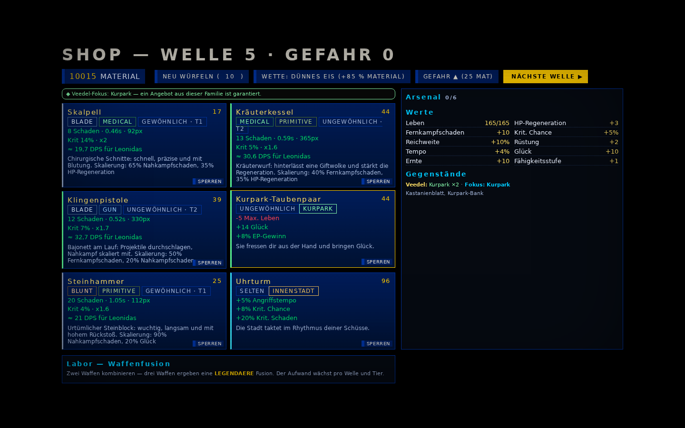
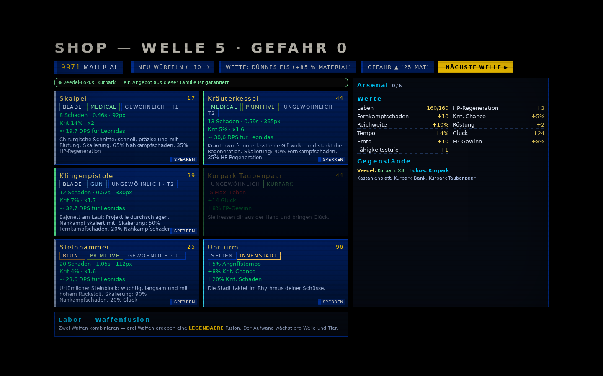
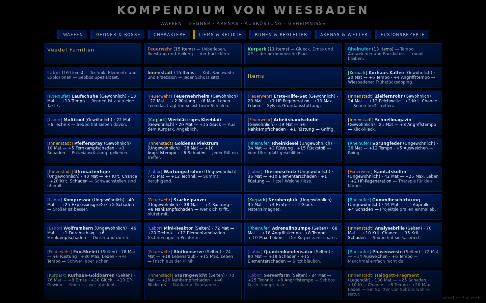

# Veedel-Familien — Live-Evidenz (2026-11-09)

**System:** fünf Item-Familien als Shop-Pool-Direktor. Die konkrete Brotato-Lücke
ist der breite, build-definierende Item-Pool: 24 neue Gegenstände, 70 insgesamt,
und ein Shop, der einen Build nach zwei gleichen Familienitems sichtbar
weiterführt. Es ist keine neue Werte-Schicht und keine neue Set-Bonus-Mechanik;
die Familien sind Daten und UI über den bestehenden Items.

## Umfang

| Familie | Items | Achse |
| --- | ---: | --- |
| Feuerwehr | 15 | Überleben, Rüstung, Heilung |
| Kurpark | 11 | Glück, Ernte, XP |
| Rheinufer | 13 | Tempo, Ausweichen, Rückstoß |
| Labor | 16 | Technik, Elemente, Explosionen |
| Innenstadt | 15 | Krit, Reichweite, Präzision |
| **Gesamt** | **70** | 24 davon neu in diesem Pass |

Fokusregel: ab **zwei** Items derselben Familie garantiert
`ShopSystem.generate()` mindestens ein Item dieser Familie. Die Rarität bleibt
wellenbegrenzt (`cap = 1 + floor(wave / 5)`), und der letzte Waffenslot wird
nicht ersetzt. Die Garantie greift nur, wenn das Angebot sonst keinen
Familientreffer hätte. Shop-Karten tragen ein Familien-Tag, der Shop zeigt den
Fokus-Hinweis, das Inventar zeigt `Veedel: … · Fokus: …`, und der Items-Tab im
Kompendium listet alle fünf Familien mit Items und Tag.

## Live-Lauf

Ausgangspunkt ist ein echter `Game.startRun()` (Leonidas, Seed `0x51ee`,
Gefahr 0). Der Spieler erhält zwei **neue** Kurpark-Items
(`kastanienblatt`, `parkbank`), dann wird die Welle über den Produktionspfad
`Game.endWave()` beendet. Das Ergebnis ist `UI.cur = scShop`,
`Game.state = shop`; das erste erzeugte Angebot hatte bereits einen neuen
Kurpark-Treffer, also **0 zusätzliche Generierungen**.

| Messung | Wert |
| --- | --- |
| Shop-Angebote | **6** |
| Fokus | **Kurpark** (2 Items) |
| Garantiertes Fokus-Angebot | **Kurpark-Taubenpaar**, 44 Material, Familie Kurpark |
| Kauf über `ShopSystem.buy()` | **Luck 10 → 24**, Max. Leben 165 → 160 (Item `-5 maxHp`) |
| Material vor/nach Kauf | **10015 → 9971** |
| Inventar | **Kurpark ×2 → ×3**, Fokus bleibt Kurpark |
| Kompendium | 5 Familien, 15/11/13/16/15 Items; alle Familiennamen im DOM |
| Konsolen-/Seitenfehler | **0** |

Der Shop steht in Welle 5; der Screenshot zeigt den echten Shop-Zustand nach
`endWave()`, nicht eine nur per `UI.show()` gesetzte Attrappe. Die
`Game.endWave()`-Transition ist zusätzlich als eigener Verifier-Pass abgesichert.

## Bilder

Die Aufnahmen nutzen **100 % UI-Skalierung** für Lesbarkeit; die automatische
Einpassung würde den dichten Shop auf einem 900-px-Viewport auf 58 % schrumpfen.
Das ist nur eine Evidenz-Zoomstufe, keine Spieländerung. Der Studio-/Sägen-
Vorspann (`#sawfx`, z-70) ist für die Aufnahmen ausgeblendet, weil er sonst
jede UI übermalt; er gehört nicht zum Shop.

### Shop mit Fokus und neuem Item



Das grüne Band nennt den Fokus, die Karte **Kurpark-Taubenpaar** trägt ihr
Familien-Tag, und rechts steht `Veedel: Kurpark ×2 · Fokus: Kurpark`.

### Nach dem Kauf



Material 9971, Leben 160/160, Glück +24, Inventar `Kurpark ×3 · Fokus: Kurpark`.
Die gekaufte Karte ist ausgegraut; der Fokus bleibt aktiv.

### Kompendium



Der Items-Tab beginnt mit der Familienübersicht und zeigt bei jedem Item den
`[Familie]`-Tag. Die Zählung im Kopf stimmt mit den Daten überein.

## Reproduzieren

```bash
eval "$(bash tools/setup-browser.sh --env)"
"$HOME/pwenv/bin/python" tools/_veedel-evidence.py
```

Das Skript schreibt `evidence.json` und die drei PNGs neu. Alle dreizehn
`checks` in `evidence.json` sind `true`; `sawfxOff` dokumentiert nur, dass der
Vorspann für die Aufnahme ausgeblendet wurde, und `naturalEndWave` belegt den
Shop-Übergang.

## Gate

```bash
node tools/verify.mjs --no-browser   # 75 pass / 0 fail / 0 skip
node tools/verify.mjs                # 121 pass / 0 fail / 0 skip
node --test tools/content-stadtgeschichte.test.mjs  # 13/13
node tools/stadtgeschichte-balance.mjs              # STADTGESCHICHTE OK
```

Der Full-Gate enthält fünf statische Pool-/Familienprüfungen und sechs
Live-Prüfungen: natürlicher Wellenende-Übergang, Fokus aus zwei Items,
garantiertes Familienangebot, Kauf mit Stat-Anwendung, Shop-Tag/Fokus-Banner
und Inventar-Familienzeile. Zusätzlich laufen der AI-Band-Regressionscheck
gegen Schwellen-Zittern (max. 3 Umkehrungen/s in einem 12-px-Band) und der
Heiler-Wandcheck (kein Pin an der Arenakante).

## Grenzen

- Der Lauf ist ein echter Engine-Lauf, aber die Welle wird nach dem Setzen der
  zwei Items über `Game.endWave()` beendet; es wurde keine vollständige
  20-Wellen-Runde mit menschlicher Eingabe gespielt.
- Headless-Chromium/Software-Renderer, keine Aussage über Gefühl, Sound oder
  Lesbarkeit an einer echten GPU.
- 70 Items sind deutlich mehr als vorher, aber weiter unter Brotatos
  Item-Katalog; der Pass schließt die **Shop-Pool-/Fokus-Lücke**, nicht jede
  Item-Parität.
- Die 24 neuen Items sind reine Stat-Items; es gibt keine neue Save-Migration
  und keine neue Set-Bonus-Schicht.
